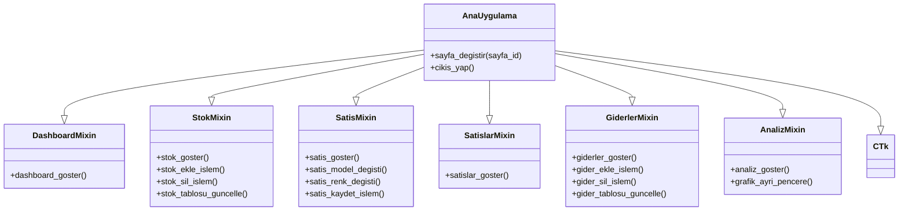
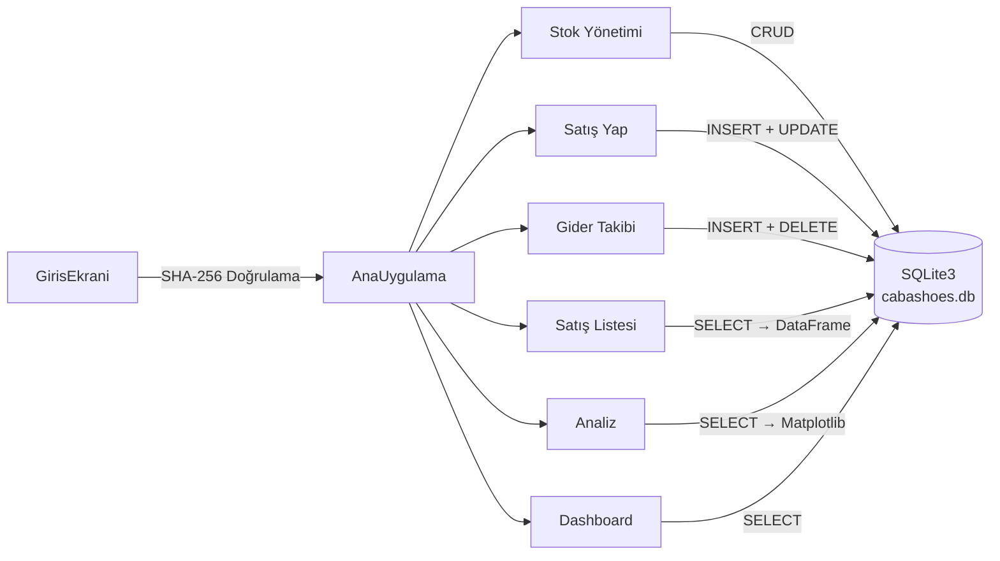

# YBS110 R VE PYHTON PROGRAMLAMA DERSİ ÖDEVİ
# 👠 Çaba Shoes – Butik Yönetim Sistemi

Kadın ayakkabı butiği için geliştirilmiş masaüstü yönetim uygulaması. Stok takibi, satış kaydı, gider yönetimi ve analiz grafiklerini tek bir panelden yönetmenizi sağlar.


---

## ✨ Özellikler

| Özellik | Açıklama |
|---|---|
| 🔐 **Güvenli Giriş** | SHA-256 ile hashlenmiş şifre doğrulama |
| 📊 **Dashboard** | Anlık stok, model sayısı, günlük satış ve ciro kartları |
| 📦 **Stok Yönetimi** | Model, renk, numara (36-40) bazında ekleme/silme |
| 💰 **Satış Kayıt** | Cascading ComboBox ile ürün seçimi, indirim hesaplama |
| 📋 **Satış Listesi** | Pandas DataFrame ile detaylı satış raporlama |
| 💸 **Gider Takibi** | Kategorili gider ekleme, toplam/günlük özet |
| 📈 **Analiz** | Matplotlib bar chart ile model bazlı satış grafikleri + kâr-zarar özeti |

---

## 📁 Proje Yapısı

```
cabashoes/
│
├── main.py                  # Ana uygulama – AnaUygulama sınıfı + başlatıcı
├── config.py                # Tema renkleri (RENKLER sözlüğü) + ctk ayarları
├── giris_ekrani.py          # Giriş (Login) ekranı sınıfı
├── database.py              # SQLite3 veritabanı işlemleri (CRUD)
├── auth.py                  # SHA-256 kimlik doğrulama + demo veri yükleme
│
├── sayfalar/                # Sayfa modülleri (Mixin pattern)
│   ├── __init__.py
│   ├── dashboard.py         # 📊 Dashboard sayfası
│   ├── stok.py              # 📦 Stok yönetimi sayfası
│   ├── satis.py             # 💰 Satış yapma sayfası
│   ├── satislar.py          # 📋 Satış listesi sayfası
│   ├── giderler.py          # 💸 Gider takibi sayfası
│   └── analiz.py            # 📈 Analiz & grafik sayfası
│
└── cabashoes.db             # SQLite veritabanı (otomatik oluşturulur)
```

### 🏗️ Mimari

Uygulama **Mixin Pattern** kullanılarak modüler bir yapıda tasarlanmıştır. Her sayfa bağımsız bir dosyada tanımlanmış olup, `AnaUygulama` sınıfı çoklu kalıtım (multiple inheritance) ile tüm sayfa metotlarını içerir:



### 🔄 Veri Akışı



---

## 🛠️ Kullanılan Kütüphaneler

| Kütüphane | Sürüm | Kullanım Amacı |
|---|---|---|
| [CustomTkinter](https://github.com/TomSchimansky/CustomTkinter) | 5.2+ | Modern ve şık GUI arayüzü |
| [Pandas](https://pandas.pydata.org/) | 3.0+ | Satış verilerini DataFrame ile işleme ve raporlama |
| [Matplotlib](https://matplotlib.org/) | 3.10+ | Model bazlı satış grafikleri (bar chart) |
| **sqlite3** | Built-in | Veritabanı yönetimi (stok, satış, gider, kullanıcı) |
| **hashlib** | Built-in | SHA-256 şifre hashleme |
| **tkinter** | Built-in | Treeview tabloları ve mesaj kutuları |

---

## 🚀 Kurulum ve Çalıştırma

### Gereksinimler
- Python 3.12 veya üzeri

### Adımlar

```bash
# 1. Repoyu klonla
git clone https://github.com/batuhd/cabashoes.git
cd cabashoes

# 2. Sanal ortam oluştur
python -m venv .venv

# 3. Sanal ortamı aktif et
# Windows:
.venv\Scripts\activate
# macOS/Linux:
source .venv/bin/activate

# 4. Bağımlılıkları yükle
pip install customtkinter pandas matplotlib

# 5. Uygulamayı çalıştır
python main.py
```

### Varsayılan Giriş Bilgileri

| Kullanıcı Adı | Şifre |
|---|---|
| `admin` | `sifre123` |

> İlk çalıştırmada veritabanı ve demo veriler otomatik oluşturulur.

---

## 📝 Lisans


